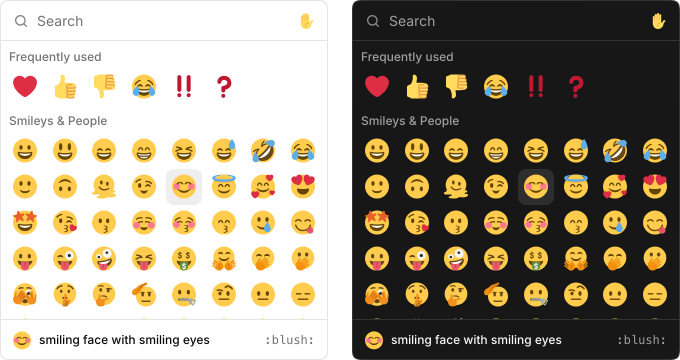

# @brianhung/emoji-picker-react



Unstyled React components for emoji pickers, reaction rows, and shortcode typeahead, built on [React Aria](https://react-spectrum.adobe.com/react-aria/).

## Installation

```bash
npm i @brianhung/emoji-picker-react
```

Or the shadcn/ui component: `npx shadcn@latest add https://emoji.brianhung.me/r/emoji-picker.json`.

## Usage

```tsx
import { EmojiPicker } from "@brianhung/emoji-picker-react";

<EmojiPicker.Root onSelect={(selection) => insert(selection.emoji)}>
  <EmojiPicker.Search>
    <EmojiPicker.Search.Input />
  </EmojiPicker.Search>
  <EmojiPicker.Viewport>
    <EmojiPicker.List />
  </EmojiPicker.Viewport>
</EmojiPicker.Root>
```

## Entry points

| Import | Contents |
|---|---|
| `@brianhung/emoji-picker-react` | `EmojiPicker.*` parts, `EmojiProvider`, `Emoji`, hooks, typeahead hooks, `pickerInitialFocus` |
| `/floating-ui`, `/react-aria` | `EmojiPopover` and `EmojiSuggestions` (`Root`, `Portal`, `Positioner`, `Popup`) on either positioning library |
| `/tokens.css`, `/theme.css`, `/shadcn.css` | Design tokens, Tailwind utilities for them, and a mapping to a shadcn/ui theme |

A Server Component can render the top-level parts through the namespace (`EmojiPicker.Root`, `EmojiPicker.Search`). It can't reach into sub-parts or `EmojiPopover`, so every part is also a flat export: `EmojiPickerSearchInput`, `EmojiPickerListCell`, `EmojiPopoverTrigger`, and so on.

## Docs

[emoji.brianhung.me](https://emoji.brianhung.me) has the API reference, examples, and the shadcn/ui registry; [docs.md](https://emoji.brianhung.me/docs.md) is the same page as Markdown.

## License

MIT. Third-party notices: [THIRD_PARTY_NOTICES.md](THIRD_PARTY_NOTICES.md).
